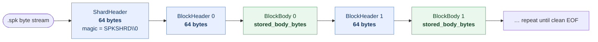
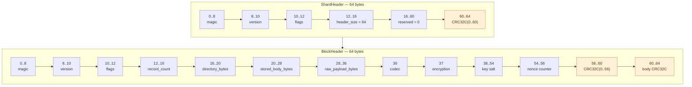
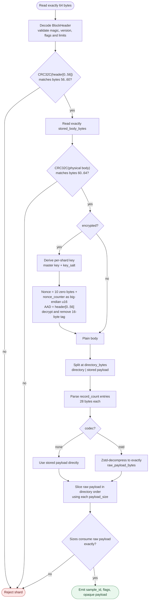
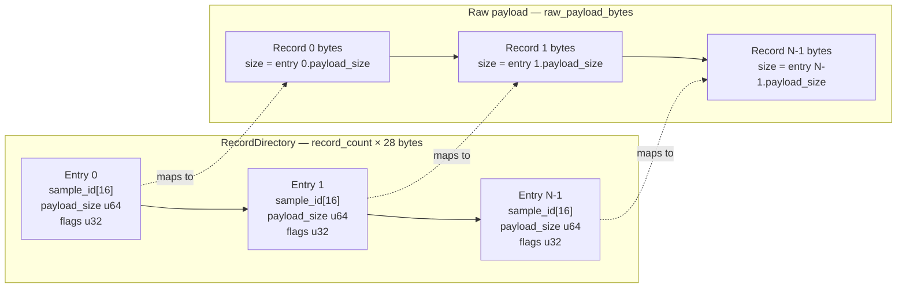

# How to parse a `.spk` shard

This is the visual companion to the normative [binary format](binary-format.md).
All integers are unsigned little-endian. Parsing is strictly sequential: no
footer, index, or seek is required.

## Physical byte stream



EOF is valid only between blocks. EOF inside a 64-byte header or block body is a
truncated shard. `ShardId` is BLAKE3 over this entire exact byte stream.

## Fixed headers



Shard and block version are always `1`. Shard flag bit 0 selects encryption.
Block codec `0` is none and `1` is Zstd. Block encryption `0` is none and `1` is
AES-256-GCM. Block flag bit 0 means a one-record jumbo block.

## Decode one block



For plaintext blocks, the physical body is:

```text
directory[directory_bytes] || stored_payload
```

For encrypted blocks, the physical body is:

```text
AES-GCM(directory || stored_payload) || authentication_tag[16]
```

`stored_body_bytes` is always the length of the complete physical body. In the
encrypted case it includes the authentication tag. After optional decryption,
split the plaintext at `directory_bytes`.

## Directory to records



Required consistency checks:

- every block's version/encryption mode agrees with the shard header;
- `directory_bytes == record_count * 28`;
- `record_count > 0`;
- a jumbo block has exactly one record;
- the sum of all `payload_size` values equals `raw_payload_bytes`;
- decompression produces exactly `raw_payload_bytes`;
- an encrypted block has a 16-byte tag and valid authentication;
- encrypted blocks use one shard salt and `nonce_counter == zero-based block index`;
- after the last complete block, the next read must be a clean EOF.

A clean EOF only proves that the stream ended on a block boundary. Verify the
manifest `byte_size` and full-object `ShardId` to detect loss of complete trailing
blocks.
